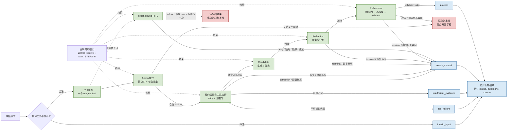
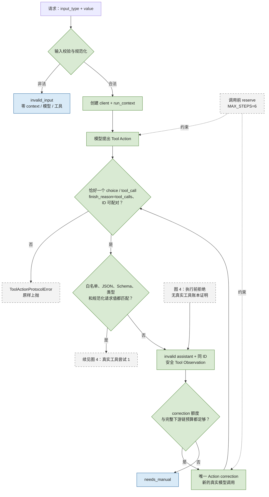
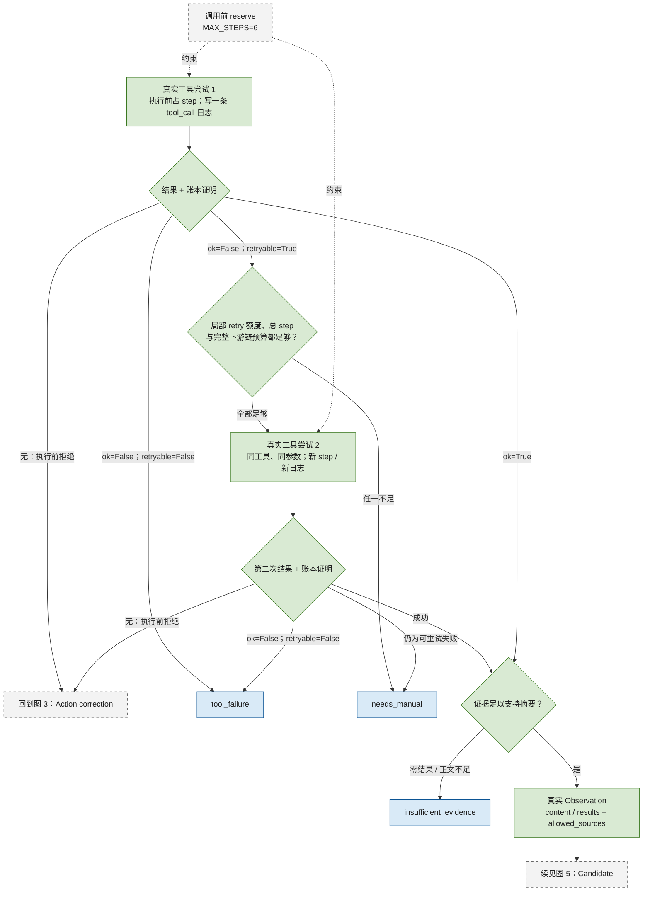
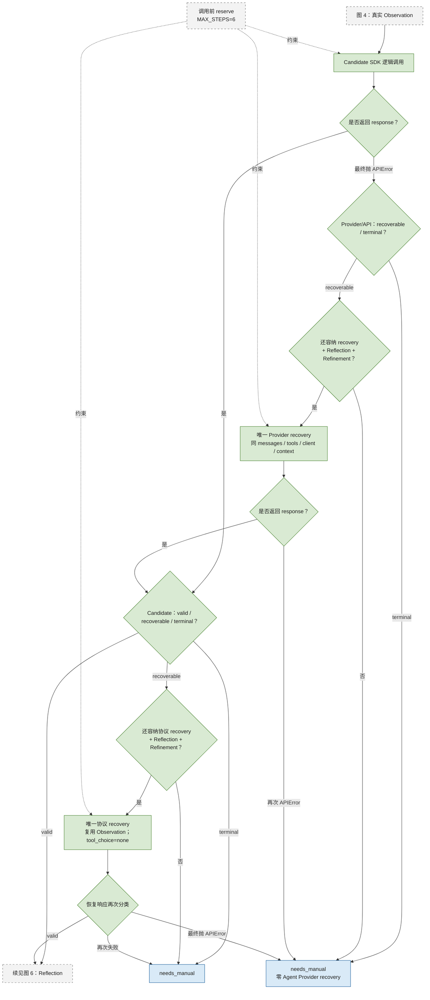
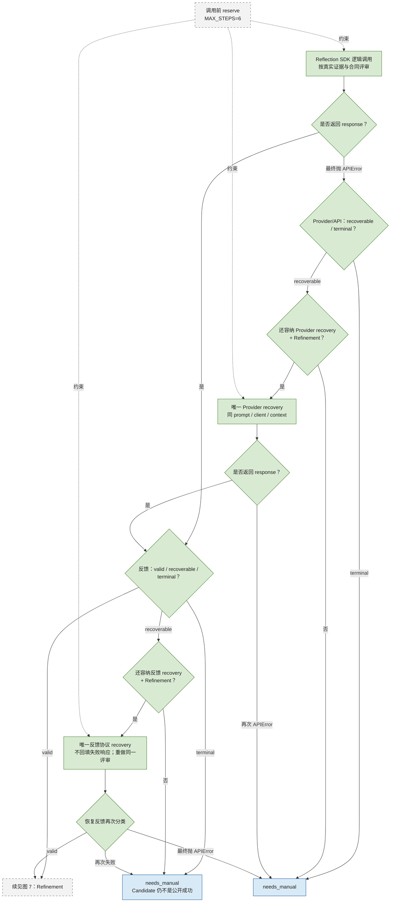
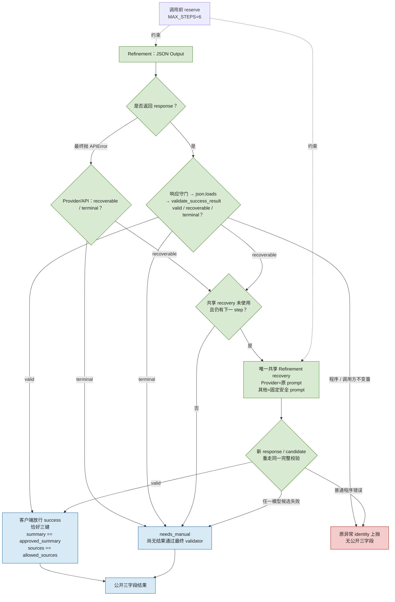
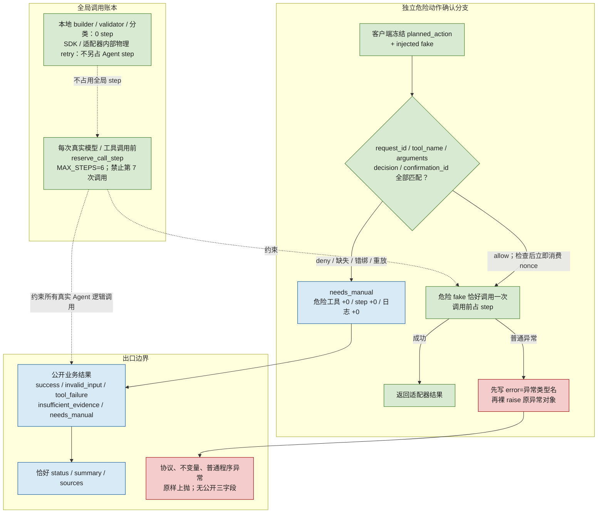

# A4-Gate 流程图图源

本页保存 [[a4-gate-research-summary-agent|A4-Gate 完整学习流程]] 的可编辑 Mermaid 图源。日常阅读优先打开 [[a4-gate-flow.canvas|A4-Gate 可缩放 Canvas]]：按 `Shift+1` 适配全图，再缩放到目标区域。生成后的 SVG 位于 `assets/a4-gate/`，Canvas 和主项目页均直接引用这些无损矢量图。

> [!important] 图源与证据边界
> “完整运行图”是权威全量视图；“运行总览 + 6 张细节图”只是把同一控制合同拆成更易读的局部视图。跨图重复的灰色节点表示阅读接口，不代表发生了额外调用。所有公开 `success` 仍必须通过客户端最终 validator；程序错误和调用方不变量错误继续原样上抛。

## 图 0：从合同到正式过关

```mermaid
%% id: a4-gate-learning-roadmap
flowchart LR
    PC["Problem Contract<br/>FINAL / PASS"] --> C1["C1<br/>输入校验 + 固定三字段 PASS"]
    C1 --> C2["C2<br/>read_material / search_web PASS"]
    C2 --> C3A["C3a<br/>工具 Schema PASS"]
    C3A --> C3B["C3b<br/>白名单调度 + 参数硬校验 PASS"]
    C3B --> C3C["C3c<br/>模型 → 工具 → Candidate PASS"]
    C3C --> C3D["C3d<br/>Reflection → Refinement<br/>→ 最终 validator PASS"]
    C3D --> C4A1["C4a-1<br/>共享 context、七字段日志、MAX、协议守门 PASS"]
    C4A1 --> C4A2["C4a-2<br/>同参数工具 retry、失败分类<br/>与证据门 PASS"]
    C4A2 --> C4B1["C4b-1<br/>Action correction + 完整链预算 PASS"]
    C4B1 --> C4B2["C4b-2<br/>Candidate / Reflection / Refinement<br/>受控恢复 PASS"]
    C4B2 --> HITL["HITL<br/>action-bound allow / deny / replay PASS"]
    HITL --> DATA["eval_cases.json V5<br/>10 normal + 3 failure + 1 danger<br/>3 holdout PASS"]
    DATA --> REVIEW{"A4-Gate 正式复核"}
    REVIEW -->|"确定性合同与安全全过；语义阈值达标"| PASS["A4-Gate PASS"]
    V4["历史 V4 唯一 RUN-4<br/>RETRY，证据永久保留"] --> DATA

    classDef done fill:#d9ead3,stroke:#38761d,color:#1f1f1f;
    classDef gate fill:#d9eaf7,stroke:#0b5394,color:#1f1f1f;
    class PC,C1,C2,C3A,C3B,C3C,C3D,C4A1,C4A2,C4B1,C4B2,HITL,DATA done;
    class V4,REVIEW,PASS gate;
```

## 图 1：请求生命周期总览

## 图 2：完整生产控制流

这张图保留所有关键节点和回流边，适合在 Canvas 中缩放审计，不适合在窄笔记视口中逐字阅读。相较旧图，补画了 `GUARD → M1_CORR` 和 `GUARD → DANGER` 两条原本已由文字合同规定、但旧图漏画的调用前 step 约束。

```mermaid
%% id: a4-gate-runtime-full
flowchart TD
    START["请求：input_type + value"] --> PRE{"C1 输入校验与规范化 ✅"}
    PRE -->|"非法"| INVALID["invalid_input<br/>固定三字段；零 context / 零模型 / 零工具"]
    PRE -->|"合法"| INIT["创建一个 client + 一个独立 run_context ✅"]

    INIT --> M1["step 1：模型选择工具<br/>reserve → clock → create → 七字段日志 ✅"]
    M1 --> F1{"恰好一个 choice / tool_call<br/>finish_reason=tool_calls、ID 可配对？ ✅"}
    F1 -->|"否"| PROTOCOL_ERROR["ToolActionProtocolError<br/>结构不足以安全配对；原样传播 ✅"]
    F1 -->|"是"| ACTION{"工具名、JSON、Schema、类型<br/>和规范化请求值都匹配？ ✅"}
    ACTION -->|"否"| ACTION_REC
    ACTION_REC["原 invalid assistant<br/>+ 同 ID 安全 Tool Observation<br/>最多请求一次 correction ✅"] --> BUDGET_A{"局部额度 + 完整链预算<br/>都足够？ ✅"}
    BUDGET_A -->|"是"| M1_CORR["correction 模型调用<br/>独立占 step / log ✅"]
    M1_CORR --> F1
    BUDGET_A -->|"否"| MANUAL_ACTION["needs_manual<br/>修正上限或完整链不足 ✅"]

    ACTION -->|"生产主链仅含两个只读工具"| TOOL1["工具入口尝试 1<br/>只有真实执行才占 step / 计时 / 写 tool_call 日志"]

    HITL_EVAL["独立 D01 安全分支<br/>客户端冻结 planned_action + injected fake ✅"] --> CONFIRM{"request_id / tool_name / arguments<br/>decision / confirmation_id 全部通过？ ✅"}
    CONFIRM -->|"deny / 缺失 / 错绑 / 重放"| MANUAL_OTHER
    CONFIRM -->|"allow；先消费 nonce"| DANGER["危险 fake 恰好调用一次<br/>调用前占 step，调用后写七字段日志 ✅"]
    DANGER --> HITL_OUT["成功返回适配器结果；普通异常记日志后原样上抛 ✅"]

    TOOL1 --> RESULT1{"返回结果<br/>账本能否证明真实工具已执行？"}
    RESULT1 -->|"无：执行前拒绝"| ACTION_REC
    RESULT1 -->|"有；ok=False 且 retryable=False"| TOOL_FAIL["tool_failure<br/>真实工具失败；不做无意义同参数重试 ✅"]
    RESULT1 -->|"有；ok=False 且 retryable=True"| RETRY_OK{"局部重试额度、总 step<br/>与完整链预算都足够？ ✅"}
    RETRY_OK -->|"任一不足"| MANUAL_RETRY["needs_manual<br/>重试额度 / 硬门 / 完整链预算停止 ✅"]
    RETRY_OK -->|"是"| TOOL2["工具入口尝试 2<br/>同一参数；真实执行时独立占下一 step / 记新日志 ✅"]
    TOOL2 --> RESULT2{"第二次结果<br/>账本能否证明真实工具已执行？"}
    RESULT2 -->|"无：执行前拒绝"| ACTION_REC
    RESULT2 -->|"有；仍为可重试失败"| MANUAL_RETRY
    RESULT2 -->|"有；ok=False 且 retryable=False"| TOOL_FAIL
    RESULT2 -->|"有；成功"| EVIDENCE
    RESULT1 -->|"有；ok=True"| EVIDENCE{"取得足够真实证据？"}
    EVIDENCE -->|"零结果 / 不足以支持摘要"| INSUFFICIENT["insufficient_evidence<br/>不得用模型常识补齐 ✅"]
    EVIDENCE -->|"是"| OBS["Observation<br/>保存真实 content / results 与 allowed_sources ✅"]

    OBS --> M2["Candidate SDK 逻辑调用<br/>无前序恢复时为 step 3；SDK 内部 retry 不另占 step ✅"]
    M2 --> CAND_API{"SDK 逻辑调用是否返回 response？ ✅"}
    CAND_API -->|"是"| CAND_CLASS{"Candidate 分类：valid / recoverable / terminal？ ✅"}
    CAND_API -->|"最终抛 APIError"| CAND_PROVIDER_CLASS{"公开异常类型 + status_code<br/>recoverable / terminal？ ✅"}
    CAND_PROVIDER_CLASS -->|"terminal"| MANUAL_CAND_API["needs_manual<br/>零 Agent Provider recovery；sources 为人工证据池 ✅"]
    CAND_PROVIDER_CLASS -->|"recoverable"| CAND_PROVIDER_BUDGET{"剩余 step 足够容纳<br/>Provider recovery + Reflection + Refinement？ ✅"}
    CAND_PROVIDER_BUDGET -->|"否"| MANUAL_CAND_API
    CAND_PROVIDER_BUDGET -->|"是"| CAND_PROVIDER_FIX["唯一 Candidate Provider recovery<br/>同 messages / tools / client / context ✅"]
    CAND_PROVIDER_FIX --> CAND_PROVIDER_RESULT{"恢复逻辑调用是否返回 response？ ✅"}
    CAND_PROVIDER_RESULT -->|"是"| CAND_CLASS
    CAND_PROVIDER_RESULT -->|"再次 APIError"| MANUAL_CAND_API
    CAND_CLASS -->|"valid"| REFLECT["首次 Reflection SDK 逻辑调用<br/>按真实证据与输出合同评审；正常链为 step 4 ✅"]
    CAND_CLASS -->|"terminal"| MANUAL_CAND["needs_manual<br/>没有摘要通过校验；sources 仅为人工证据池 ✅"]
    CAND_CLASS -->|"recoverable"| CAND_BUDGET{"剩余 step 足够容纳<br/>recovery + Reflection + Refinement？ ✅"}
    CAND_BUDGET -->|"否"| MANUAL_CAND
    CAND_BUDGET -->|"是"| CAND_FIX["Candidate 协议 recovery 恰好一次<br/>复用真实 Observation；tool_choice=none ✅"]
    CAND_FIX --> CAND_PROTOCOL_API{"协议 recovery SDK 调用<br/>是否返回 response？ ✅"}
    CAND_PROTOCOL_API -->|"是"| CAND_CLASS2{"恢复响应再次分类<br/>是否 valid？ ✅"}
    CAND_PROTOCOL_API -->|"最终抛 APIError"| MANUAL_CAND_API
    CAND_CLASS2 -->|"是"| REFLECT
    CAND_CLASS2 -->|"terminal / recoverable"| MANUAL_CAND

    REFLECT --> REF_API{"Reflection SDK 逻辑调用<br/>是否返回 response？ ✅"}
    REF_API -->|"是"| REF_CLASS{"Reflection 分类：valid / recoverable / terminal？ ✅"}
    REF_API -->|"最终抛 APIError"| REF_PROVIDER_CLASS{"公开异常类型 + status_code<br/>recoverable / terminal？ ✅"}
    REF_PROVIDER_CLASS -->|"terminal"| MANUAL_REF_API["needs_manual<br/>恢复计数按实际额外调用；sources 为人工证据池 ✅"]
    REF_PROVIDER_CLASS -->|"recoverable"| REF_PROVIDER_BUDGET{"剩余 step 足够容纳<br/>Provider recovery + Refinement？ ✅"}
    REF_PROVIDER_BUDGET -->|"否"| MANUAL_REF_API
    REF_PROVIDER_BUDGET -->|"是"| REF_PROVIDER_FIX["唯一 Reflection Provider recovery<br/>同 prompt / client / context ✅"]
    REF_PROVIDER_FIX --> REF_PROVIDER_RESULT{"恢复逻辑调用是否返回 response？ ✅"}
    REF_PROVIDER_RESULT -->|"是"| REF_CLASS
    REF_PROVIDER_RESULT -->|"再次 APIError"| MANUAL_REF_API
    REF_CLASS -->|"valid"| REFINE["Refinement：JSON Output<br/>无重试正常链为 step 5 ✅"]
    REF_CLASS -->|"terminal"| MANUAL_REF["needs_manual<br/>已有合法 Candidate；sources 仅为人工证据池 ✅"]
    REF_CLASS -->|"recoverable"| REF_BUDGET{"剩余 step 足够容纳<br/>Reflection recovery + Refinement？ ✅"}
    REF_BUDGET -->|"否"| MANUAL_REF
    REF_BUDGET -->|"是"| REF_FIX["Reflection protocol recovery 恰好一次<br/>不回填失败响应；只重做同一评审 ✅"]
    REF_FIX --> REF_PROTOCOL_API{"协议 recovery SDK 调用<br/>是否返回 response？ ✅"}
    REF_PROTOCOL_API -->|"是"| REF_CLASS2{"恢复反馈再次分类<br/>是否 valid？ ✅"}
    REF_PROTOCOL_API -->|"最终抛 APIError"| MANUAL_REF_API
    REF_CLASS2 -->|"valid"| REFINE
    REF_CLASS2 -->|"terminal / recoverable"| MANUAL_REF

    REFINE --> REFINE_API{"Refinement SDK 逻辑调用<br/>是否返回 response？ ✅"}
    REFINE_API -->|"最终抛 APIError"| REFINE_PROVIDER_CLASS{"公开异常类型 + status_code<br/>recoverable / terminal？ ✅"}
    REFINE_API -->|"是"| REFINE_CLASS{"响应守门 → json.loads → candidate validator<br/>valid / recoverable / terminal？ ✅"}
    REFINE_PROVIDER_CLASS -->|"terminal"| MANUAL_REFINE["needs_manual<br/>尚无结果通过最终 validator；sources 为人工证据池 ✅"]
    REFINE_PROVIDER_CLASS -->|"recoverable"| REFINE_REC_BUDGET{"共享 recovery 未使用<br/>且仍有下一 step？ ✅"}
    REFINE_CLASS -->|"valid"| SUCCESS["success<br/>summary + 本轮真实 sources ✅"]
    REFINE_CLASS -->|"terminal"| MANUAL_REFINE
    REFINE_CLASS -->|"recoverable"| REFINE_REC_BUDGET
    REFINE_CLASS -->|"程序 / 调用方不变量"| PROGRAM_ERROR["普通 Python / 不变量错误<br/>保持原 identity 上抛 ✅"]
    REFINE_REC_BUDGET -->|"否"| MANUAL_REFINE
    REFINE_REC_BUDGET -->|"是"| REFINE_REC["唯一 Refinement recovery<br/>Provider=原 prompt；其他=固定安全 prompt ✅"]
    REFINE_REC --> REFINE_REC_RESULT{"新 response / candidate<br/>重走同一完整校验 ✅"}
    REFINE_REC_RESULT -->|"valid"| SUCCESS
    REFINE_REC_RESULT -->|"任一 Provider / response / JSON / candidate 失败"| MANUAL_REFINE
    REFINE_REC_RESULT -->|"普通程序错误"| PROGRAM_ERROR
    MANUAL_OTHER["needs_manual<br/>危险工具 +0 / step +0 / 日志 +0 ✅"]

    GUARD["全局护栏<br/>每次真实模型/工具调用前 reserve_call_step<br/>MAX_STEPS=6；禁止第 7 次调用 ✅"] -.约束.-> M1
    GUARD -.约束.-> M1_CORR
    GUARD -.约束.-> TOOL1
    GUARD -.约束.-> TOOL2
    GUARD -.约束.-> M2
    GUARD -.约束.-> CAND_PROVIDER_FIX
    GUARD -.约束.-> CAND_FIX
    GUARD -.约束.-> REFLECT
    GUARD -.约束.-> REF_PROVIDER_FIX
    GUARD -.约束.-> REF_FIX
    GUARD -.约束.-> REFINE
    GUARD -.约束.-> REFINE_REC
    GUARD -.约束.-> DANGER

    INVALID --> OUT["所有公开业务结果都恰好：status / summary / sources"]
    MANUAL_ACTION --> OUT
    TOOL_FAIL --> OUT
    INSUFFICIENT --> OUT
    MANUAL_RETRY --> OUT
    MANUAL_CAND --> OUT
    MANUAL_CAND_API --> OUT
    MANUAL_REF --> OUT
    MANUAL_REF_API --> OUT
    MANUAL_REFINE --> OUT
    MANUAL_OTHER --> OUT
    SUCCESS --> OUT

    classDef done fill:#d9ead3,stroke:#38761d,color:#1f1f1f;
    classDef terminalDone fill:#d9eaf7,stroke:#0b5394,color:#1f1f1f;
    classDef note fill:#f3f3f3,stroke:#666666,color:#1f1f1f;
    class PRE,INIT,M1,F1,ACTION,ACTION_REC,BUDGET_A,M1_CORR,TOOL1,RETRY_OK,TOOL2,RESULT1,RESULT2,EVIDENCE,OBS,M2,CAND_API,CAND_PROVIDER_CLASS,CAND_PROVIDER_BUDGET,CAND_PROVIDER_FIX,CAND_PROVIDER_RESULT,CAND_CLASS,CAND_BUDGET,CAND_FIX,CAND_PROTOCOL_API,CAND_CLASS2,REFLECT,REF_API,REF_PROVIDER_CLASS,REF_PROVIDER_BUDGET,REF_PROVIDER_FIX,REF_PROVIDER_RESULT,REF_CLASS,REF_BUDGET,REF_FIX,REF_PROTOCOL_API,REF_CLASS2,REFINE,REFINE_API,REFINE_PROVIDER_CLASS,REFINE_CLASS,REFINE_REC_BUDGET,REFINE_REC,REFINE_REC_RESULT,HITL_EVAL,CONFIRM,DANGER,HITL_OUT done;
    class INVALID,SUCCESS,MANUAL_RETRY,MANUAL_ACTION,MANUAL_CAND,MANUAL_CAND_API,MANUAL_REF,MANUAL_REF_API,MANUAL_REFINE,TOOL_FAIL,INSUFFICIENT,MANUAL_OTHER terminalDone;
    class PROTOCOL_ERROR,PROGRAM_ERROR,START,GUARD,OUT note;
```

## 图 3：输入、Action 协议与一次 correction

## 图 4：真实工具、同参数 retry 与证据门

## 图 5：Candidate 的双层恢复

## 图 6：Reflection 的双层恢复

## 图 7：Refinement、共享 recovery 与最终 exact gate

## 图 8：action-bound HITL、全局账本与出口边界

## 阅读顺序与维护规则

1. 第一次学习：图 0 → 图 1 → 图 3～8。
2. 查整条控制流：在 Canvas 中打开图 2，按 `Shift+1` 适配后局部缩放。
3. 查具体代码职责：跳转 [[a4-gate-function-call-reference|A4-Gate 函数调用参考]]。
4. 修改控制合同后：先更新本页 Mermaid 图源，再重新生成同名 SVG，并检查 [[a4-gate-flow.canvas|Canvas]] 的文件节点仍能打开。

> [!note] SVG 不替代图源
> `assets/a4-gate/*.svg` 是为了完整缩放与跨设备查看而生成的展示产物；本页 Mermaid 才是可编辑图源。Canvas 只负责布局和导航，不改变任何 Agent 运行语义。

## 相关链接

- [[a4-gate-flow.canvas|A4-Gate 可缩放 Canvas]]
- [[a4-gate-research-summary-agent|A4-Gate 完整学习流程]]
- [[a4-gate-function-call-reference|A4-Gate 函数调用参考]]
- [[../../../07-Reviews/AI-Agent-Learning/2026-08-24-a4-gate-pass-review|A4-Gate 正式 PASS 复盘]]
