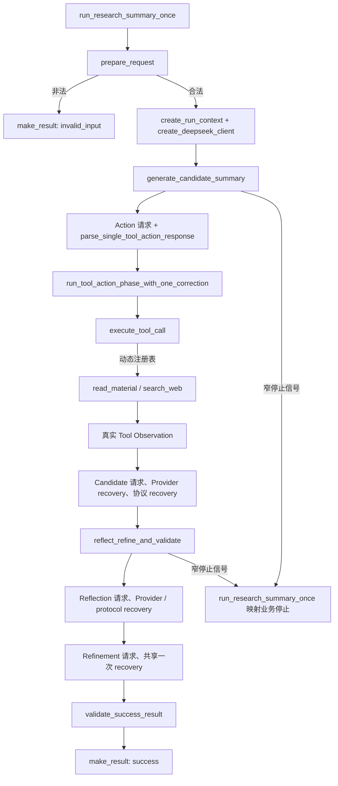

# A4-Gate 函数调用参考

这张参考页对应最终 `A4-Gate = PASS` 的生产模块，逐项解释当前源码中的 **62 个顶层函数、6 个嵌套 helper、11 个异常构造函数和 13 个顶层异常类**；也就是 AST 中的 **79 个 `FunctionDef` 全覆盖**。学习主线、设计演进与最终证据见 [[a4-gate-research-summary-agent|A4-Gate 研究摘要 Agent]]；这里专门回答三个问题：

1. 每个函数负责什么；
2. 谁调用它、它再调用谁；
3. 它是否会产生模型、工具、网络、step 或日志副作用。

> [!important] 版本边界
> 本页绑定的计分生产源码为 `243712 bytes / SHA-256 A6190964BFC7B70EED6F929C2495AC291CEBA441B1BFE5001B6A4EFC6D6F5DC6`。为保持 RUN-5 证据可复现，源码模块开头的阶段性 docstring 没有在正式复核后改写；最终状态以 `problem-contract.md` 的 `FINAL / PASS`、`daily/2026-08-24.md` 和本页为准。

## 一眼看懂主调用链



名义正常链只有五个 Agent step：

```text
step 1  Action 模型
step 2  客户端真实工具
step 3  Candidate 模型
step 4  Reflection 模型
step 5  Refinement 模型
         本地 validator：不占 step
```

模型只提出 Action、生成 Candidate、给出 Reflection 和 Refinement；客户端才拥有输入校验、工具执行、恢复决策、step / 日志、HITL 与最终 success 放行权。

## 调用与副作用图例

| 标记 | 含义 |
|---|---|
| 纯函数 | 不调用模型、工具或网络，也不占 step / 写七字段日志 |
| 逻辑模型调用 | 调用一次 `client.chat.completions.create()`；调用前 reserve，结束后恰好写一条聚合日志 |
| 逻辑工具调用 | 客户端执行一次注册工具；真实执行前 reserve，结束后恰好写一条工具日志 |
| 物理传输恢复 | 同一次 `search_web` 逻辑调用内部最多 1～3 次同参数 GET；不额外占 Agent step / 日志 |
| 动态调用 | AST 静态调用图看不到，由注册表或注入的 callable 决定真实被调函数 |

## 1. 请求账本、预算、结果与 HITL

| # | 函数 | 作用 | 谁调用它 | 它调用什么 / 副作用 |
|---:|---|---|---|---|
| 1 | `create_run_context()` | 为一次公开 Agent 请求创建独立 `request_id / step / logs`。 | `run_research_summary_once` | 纯本地；step 初始为 0。 |
| 2 | `consume_action_bound_confirmation()` | 严格校验 confirmation 结构、动作绑定、decision 与 replay，并在副作用前一次性消费 fresh allow/deny ID。 | `execute_high_risk_action_with_confirmation` | 只改变受信的 `consumed_confirmation_ids`；stop 分支不碰账本。 |
| 3 | `has_action_correction_budget()` | 同时检查 Action correction 局部额度和完整尾链预算。 | `request_and_parse_action_correction` | 纯函数；不占 step。 |
| 4 | `has_tool_retry_completion_budget()` | 判断剩余 step 是否容得“第二次工具 + Candidate + Reflection + Refinement”。 | `generate_candidate_summary` | 纯函数。 |
| 5 | `has_candidate_recovery_completion_budget()` | 判断剩余 step 是否容得“Candidate recovery + Reflection + Refinement”。 | Candidate Provider / protocol 编排与公开入口对账 | 纯函数。 |
| 6 | `has_reflection_recovery_completion_budget()` | 判断剩余 step 是否容得“Reflection recovery + Refinement”。 | Reflection Provider / protocol 编排与公开入口对账 | 纯函数。 |
| 7 | `has_refinement_recovery_budget()` | 判断首次 Refinement 失败后是否还有唯一下一步。 | `resolve_refinement_stage` 与公开入口对账 | 纯函数。 |
| 8 | `reserve_call_step()` | 在任何真实模型、逻辑工具或危险 fake 调用前占用下一 step；拒绝 step 7，区分正常耗尽与损坏账本。 | 所有真实调用 helper | 修改当前请求的共享 step；自身不调用外部系统。 |
| 9 | `append_call_log()` | 校验并恰好追加一条固定七字段调用事件。 | 所有真实调用 helper | 修改当前请求的 logs；模型 / 工具身份字段互斥。 |
| 10 | `make_result()` | 统一构造恰好 `status / summary / sources` 三字段结果。 | 输入门、validator、公开停止映射、HITL | 纯函数；防御性复制 sources。 |
| 11 | `build_high_risk_confirmation_stop_result()` | 把 deny、missing、invalid、mismatch、replay 等确认门结果转成固定 `needs_manual`。 | `execute_high_risk_action_with_confirmation` | 调 `make_result`；不执行 fake。 |
| 12 | `execute_high_risk_action_with_confirmation()` | 连接动作绑定确认门与显式注入的高风险 fake；只有 fresh exact allow 才执行一次。 | D01 eval / 调用方显式使用 | 动态调用 `action_executor`；allow 时 reserve + 一条 tool log；异常日志写类型名后裸抛。 |

### HITL 的关键调用顺序

```text
校验 executor 调用方不变量
→ consume_action_bound_confirmation
→ stop：直接 needs_manual，fake/step/log 全部 +0
→ allow：confirmation_id 已消费
→ reserve_call_step
→ 调用注入 fake
→ 成功或异常都写一条 tool_call 日志
```

这实现的是 **at-most-once（至多一次）授权尝试**。fake timeout、预算门失败或未知状态后不能重放原 confirmation；若确实需要再次尝试，必须重新冻结动作并取得新的 confirmation ID。

## 2. 输入门与真实工具适配

| # | 函数 | 作用 | 谁调用它 | 它调用什么 / 副作用 |
|---:|---|---|---|---|
| 13 | `validate_request_shape()` | 检查原始请求是 dict 且具备入口所需字段。 | `prepare_request` | 纯函数。 |
| 14 | `normalize_required_string()` | 对必填字符串做运行时类型门和首尾空白规范化。 | `prepare_request`、`read_material`、`search_web` | 纯函数。 |
| 15 | `validate_input_type()` | 只允许 `topic` 或 `relative_path`。 | `prepare_request` | 纯函数。 |
| 16 | `validate_topic_value()` | 校验规范化 topic 的非空与长度边界。 | `prepare_request`、`search_web` | 纯函数。 |
| 17 | `validate_relative_path_value()` | 拒绝 URL、绝对路径、越界解析和非法相对路径，保证最终落点留在 sandbox。 | `prepare_request`、`read_material` | 纯函数；既在入口校验，也在执行时重验。 |
| 18 | `prepare_request()` | 组合入口所有校验；合法返回规范化请求，非法直接构造 `invalid_input`。 | `run_research_summary_once` | 调 13～17 与 `make_result`；非法时 client/context/model/tool/step/log 均为 0。 |
| 19 | `read_material()` | UTF-8 读取 sandbox 文件，最多保留 1000 字符并返回严格 `ok/content/truncated` 或稳定失败。 | `execute_tool_call` 通过 `TOOL_REGISTRY` 动态调用 | 真实文件 I/O；一次逻辑工具调用的一部分。普通程序错误不宽泛吞掉。 |
| 20 | `build_complete_search_evidence_snippet()` | HTML 清理后保留截至明确句末的最大完整句前缀。 | `search_web`、`derive_allowed_sources`、`build_approved_summary` | 纯函数；避免把半句当批准证据。 |
| 21 | `_exception_chain_contains_type()` | 只沿 cause/context/reason/args 按异常对象类型查找，不解析异常正文。 | `_request_wikipedia_search_json` | 纯函数。 |
| 22 | `_request_wikipedia_search_json()` | 一次逻辑搜索内部执行最多 1～3 次同参数、只读 GET，并对传输 / HTTP / JSON 失败分类。 | `search_web` | 真实 Wikipedia HTTP；内部 GET 恢复不额外占 Agent step/log。 |
| 23 | `search_web()` | 查询中文 Wikipedia，严格校验响应结构、pageid/title/snippet，并生成 curid URL。 | `execute_tool_call` 通过 `TOOL_REGISTRY` 动态调用 | 调 14、16、20～22；返回 Tool Observation，不调用模型。 |
| 24 | `build_tool_schemas()` | 生成模型可见的两个只读 function-tool Schema。 | Action / Candidate recovery 请求与 `execute_tool_call` | 纯函数；只描述工具，不执行工具。 |
| 25 | `execute_tool_call()` | 对不可信 tool name / raw JSON 做白名单、schema、精确类型、路由和值绑定，再执行一次匹配工具并记账。 | `execute_and_classify_tool_action`；工具 retry 兼容路径 | 通过 `TOOL_REGISTRY` 动态调用 19 或 23；只有通过 preflight 后才 reserve、计时、写一条 tool log。 |

`TOOL_REGISTRY` 的最终生产能力只有：

```text
read_material → read_material()
search_web    → search_web()
```

危险 fake 从不加入生产注册表或模型工具 Schema，只能通过 HITL helper 的显式依赖注入进入确定性测试。

## 3. Action 解析、执行、修正与工具终点

| # | 函数 | 作用 | 谁调用它 | 它调用什么 / 副作用 |
|---:|---|---|---|---|
| 26 | `build_action_validation_observation()` | 用原 `tool_call_id` 构造安全的协议级 validation Tool Observation。 | `request_and_parse_action_correction` | 纯函数；不回显 raw args、prompt、request ID 或日志。 |
| 27 | `extract_preexecution_action_validation_error()` | 用调用前后 step/log 快照证明某失败发生在真实工具执行前。 | `execute_and_classify_tool_action` | 纯函数；只有 `+0/+0` 才归 Action validation。 |
| 28 | `execute_and_classify_tool_action()` | 执行一次未信任 Action，并区分 preflight 拒绝与真实工具结果。 | `run_tool_action_phase_with_one_correction` | 调 `execute_tool_call` 和 27；真实执行才有工具副作用。 |
| 29 | `raise_for_terminal_tool_outcome()` | 只有账本证明真实执行后，才把不可重试失败或搜索零结果变成窄终点。 | `generate_candidate_summary` | 纯分类；可抛 `TerminalToolOutcomeError`。 |
| 30 | `create_deepseek_client()` | 创建显式冻结 `base_url / model / max_retries=2 / timeout=60s` 的共享 client。 | 公开编排和所有可独立使用的模型请求 helper | 创建 SDK 客户端，不立即调用模型。 |
| 31 | `request_action_correction()` | 发起恰好一次 Action correction 模型请求。 | `request_and_parse_action_correction` | build schemas；reserve → SDK create → 一条 model log。 |
| 32 | `parse_single_tool_action_response()` | 从 SDK 属性对象提取一个结构明确、内容仍未信任的单一 Tool Action。 | 初次 Action 和 correction | 纯协议解析；不验证工具业务参数，也不执行工具。 |
| 33 | `request_and_parse_action_correction()` | 预算允许时，把 invalid assistant + 同 ID validation Observation 回填，再请求并解析一次修正 Action。 | `run_tool_action_phase_with_one_correction` | 调 3、26、31、32；新的模型调用独立占 step/log。 |
| 34 | `run_tool_action_phase_with_one_correction()` | 编排 initial Action，若被证明为 preflight 拒绝则最多 correction 一次，再执行 corrected Action。 | `generate_candidate_summary` | 调 28、33；不宽泛捕获 Provider、协议或程序错误。 |

Action 的职责顺序是：

```text
模型提出 Action
→ parser 只证明“能否确定一个可配对 Action”
→ executor 校验白名单 / JSON / schema / 本轮请求绑定
→ preflight 拒绝可形成安全 Observation
→ 预算允许时模型 correction 一次
→ 只有合法 Action 才执行真实工具
```

工具返回 `ok=False` 并不自动等于 `tool_failure`。必须先由 step/log provenance 证明注册工具确实执行；否则同形结果仍可能只是客户端执行前拒绝。

## 4. Provider / 响应分类与 Candidate 阶段

| # | 函数 | 作用 | 谁调用它 | 它调用什么 / 副作用 |
|---:|---|---|---|---|
| 35 | `classify_provider_api_error()` | 仅依据公开 SDK 异常类型与安全 status code 分类 recoverable / terminal。 | Candidate、Reflection、Refinement 与公开映射 | 纯函数；不读取 `str(exc)`、body、headers 或 request ID。 |
| 36 | `classify_candidate_summary_response()` | 将不可信文本响应分成 `valid / recoverable / terminal`。 | Candidate resolver、Candidate recovery，以及 Reflection/Refinement 共用底层守门 | 纯函数；先看 terminal `finish_reason`，再检查 message/tool_calls/content。 |
| 37 | `classify_reflection_feedback_response()` | 复用文本外壳门，并把合法正文归一为 feedback。 | Reflection resolver / recovery | 调 36；纯函数。 |
| 38 | `classify_refinement_response()` | 复用文本响应门，只在合法正文上执行 `json.loads()`，返回 candidate 或安全原因。 | Refinement helper / resolver | 调 36；纯函数；JSON 合法仍不等于 success 合同合法。 |
| 39 | `build_candidate_recovery_messages()` | 从原 Tool Observation 后追加固定、安全的 Candidate 修订指令。 | `attempt_candidate_recovery_once` | 纯函数；不加入失败 Candidate，不重跑工具。 |
| 40 | `request_candidate_summary_response()` | 发起恰好一次 post-tool Candidate 逻辑 SDK 调用并原样返回 response。 | `request_candidate_summary_with_one_provider_recovery` | reserve → SDK create → 一条 model log；明确 `tool_choice="none"`。 |
| 41 | `request_candidate_summary_with_one_provider_recovery()` | 首次 Candidate Provider/API 失败后，在白名单与三步尾链预算允许时追加一次逻辑调用。 | `generate_candidate_summary` | 调 5、30、35、40；返回 response 与实际 Provider recovery 次数。 |
| 42 | `request_candidate_recovery_response()` | 针对 API 已返回但 Candidate 协议/正文可恢复失败，发起唯一 protocol recovery。 | `attempt_candidate_recovery_once` | reserve → 模型 → log；使用安全消息且禁止工具。 |
| 43 | `attempt_candidate_recovery_once()` | 把首次 recoverable 分类推进到唯一恢复后的新分类。 | `resolve_candidate_summary_stage` | 调 5、36、39、42；不递归、不循环。 |
| 44 | `resolve_candidate_summary_stage()` | 返回合法 Candidate 原文，或对 terminal、恢复失败、尾链不足发窄停止信号。 | `generate_candidate_summary` | 调 5、35、36、43 与 `derive_allowed_sources`；自身不额外调用工具。 |
| 45 | `generate_candidate_summary()` | 运行 Action → 工具 → Tool Observation → Candidate 的整个前半链，并返回内部接力数据。 | `run_research_summary_once` | 初次 Action 模型直接 reserve/create/log；调 24、25、29、30、32、34、41、44、46；必要时同参数工具 retry 一次。 |

Candidate recovery 分两类：

- Provider recovery：SDK 逻辑调用最终抛出白名单 APIError，API 没有返回可分类 response；
- protocol recovery：API 已返回，但 `finish_reason`、外壳、tool calls 或 content 不满足 Candidate 合同。

两类 counter 按“为什么发出额外调用”归属；本地分类不计调用。任何恢复都必须给后续 Reflection 和 Refinement 留出完整位置。

## 5. 证据所有权、Reflection、Refinement 与最终硬门

| # | 函数 | 作用 | 谁调用它 | 它调用什么 / 副作用 |
|---:|---|---|---|---|
| 46 | `derive_allowed_sources()` | 只从规范化请求与真实成功 Tool Observation 派生唯一来源列表。 | Candidate/Reflection 编排与公开停止对账 | 调 20；纯函数。模型 Candidate 无权提供来源白名单。 |
| 47 | `build_approved_summary()` | 从主搜索 snippet 或文件 `content + truncated` 状态确定性构造唯一批准正文。 | `reflect_refine_and_validate` | 调 20；纯函数；V5 exact-summary gate 的客户端权威值。 |
| 48 | `build_reflection_prompt()` | 把规范化请求、Candidate、真实 Observation、allowlist 与评审标准放入 Reflection prompt。 | `reflect_refine_and_validate` | 纯字符串构造；模型调用 0。 |
| 49 | `build_refinement_prompt()` | 构造 JSON-only Refinement prompt，要求逐字符复制 approved summary、逐项复制 allowed sources。 | `reflect_refine_and_validate` | 纯字符串构造；模型调用 0。 |
| 50 | `build_reflection_recovery_prompt()` | 在原评审合同后追加与固定 reason 对应的安全 recovery 指令。 | `attempt_reflection_recovery_once` | 纯函数；失败反馈不进入 prompt。 |
| 51 | `build_refinement_recovery_prompt()` | 在原 Refinement prompt 后追加固定安全纠错指令。 | `resolve_refinement_stage` | 纯函数；只接受安全 reason，禁止失败 candidate、越界值和异常正文。 |
| 52 | `validate_success_result()` | 最终硬校验：客户端权威参数先验合法；candidate exact 三键、status、summary、sources 全部精确。 | `resolve_refinement_stage`；direct checks | 调 `make_result`；不占 step。Candidate 错误抛 `InvalidSuccessCandidateError`，调用方不变量抛内建 `ValueError`。 |
| 53 | `request_reflection_response()` | 发起恰好一次 Reflection 逻辑 SDK 调用并原样返回 response。 | 初次 Provider recovery helper、protocol recovery、兼容 wrapper | reserve → SDK create → 一条 model log。 |
| 54 | `request_initial_reflection_with_one_provider_recovery()` | 首次 Reflection APIError 后，在白名单与两步尾链预算允许时追加一次 Provider recovery。 | `reflect_refine_and_validate` | 调 6、30、35、53；返回 response 与实际 Provider recovery 次数。 |
| 55 | `request_reflection_feedback()` | 旧调用者兼容入口：调用一次原始 Reflection request，并保留单次反馈行为。 | 直接测试 / 旧调用者；当前主链不直接调用 | 调 53；有一次真实模型调用。 |
| 56 | `attempt_reflection_recovery_once()` | 对 API 已返回的 recoverable Reflection 响应做唯一 protocol recovery。 | `resolve_reflection_feedback_stage` | 调 6、37、50、53；恢复成功后仍需 Refinement。 |
| 57 | `resolve_reflection_feedback_stage()` | 合并首次 response、Provider 计数与 protocol recovery，返回合法反馈或窄停止信号。 | `reflect_refine_and_validate` | 调 6、35、37、56；对账 step、两套计数和来源。 |
| 58 | `request_refinement_response()` | 发起恰好一次 Refinement SDK 调用并原样返回任意 response。 | 单次兼容 helper 与最终 resolver | reserve → SDK create → 一条 model log；使用 JSON Output。 |
| 59 | `request_refinement_candidate()` | 旧调用者兼容入口：一次 Refinement 调用后执行响应 / JSON 分类。 | direct tests / 旧调用者；当前主链由 resolver 接管 | 调 38、58；不会执行最终 validator。 |
| 60 | `resolve_refinement_stage()` | 编排首次 Refinement、四失败域共享的唯一 recovery、每份候选的完整 validator。 | `reflect_refine_and_validate` | 调 7、30、35、38、51、52、58；Provider 失败复用原 prompt，其余用安全 recovery prompt。 |
| 61 | `reflect_refine_and_validate()` | 运行完整后半链：派生权威正文/来源 → Reflection → Refinement → validator。 | `run_research_summary_once` | 调 30、46～49、54、57、60；成功只来自 52。 |
| 62 | `run_research_summary_once()` | 唯一公开研究摘要入口；输入早停、共享 client/context、前半链、后半链与窄业务停止映射都在这里汇合。 | 外部调用者 / RUN-5 | 调 1、5～7、18、30、35、45、46、61、`make_result`；普通程序/不变量异常保持原对象上抛。 |

## 6 个嵌套 helper 与 11 个异常构造函数

这些定义不会作为模块级 API 单独调用，但仍属于源码中的函数定义。

### 嵌套 helper（6/6）

| 完整位置 | 作用 | 由谁调用 / 副作用 |
|---|---|---|
| `classify_provider_api_error.make_classification()` | 把 Provider 分类压成固定 `classification / reason / status_code` 三字段内部对象。 | 只被外层分类器各分支调用；纯函数。 |
| `classify_candidate_summary_response.make_classification()` | 把 Candidate 分类压成固定 `classification / reason / candidate_summary` 三字段对象。 | 只被外层 Candidate 分类器调用；纯函数。 |
| `classify_candidate_summary_response.read_attribute()` | 使用唯一 sentinel 区分“属性缺失”和“属性存在但值为 None”。 | 外层 Candidate 分类器逐层读取 SDK-like 对象；纯函数。 |
| `resolve_refinement_stage.evaluate_response()` | 对一次 Refinement response 做响应/JSON 分类，并对 candidate 运行 exact validator；统一返回 success 或内部 failure。 | 首次和 recovery response 共用；不发模型调用。 |
| `resolve_refinement_stage.provider_failure()` | 把一次 `APIError` 通过共享 Provider 分类器转成 Refinement failure 对象。 | 首次和 recovery Provider 异常共用；不读取异常正文。 |
| `resolve_refinement_stage.raise_stop()` | 根据 stop kind、failure、次数和 step 构造并抛出 `RefinementStageStopError`。 | Refinement resolver 的所有安全停止出口；只构造窄信号。 |

### 异常构造函数（11/11）

| 构造函数 | 保存 / 校验的字段 | 调用边界 |
|---|---|---|
| `AutoRecoveryExhaustedError.__init__()` | `reason / attempts / last_error` | 工具自动恢复耗尽时创建。 |
| `TerminalToolOutcomeError.__init__()` | 精确 `status / detail` | 只接受 `tool_failure / insufficient_evidence`。 |
| `ActionCorrectionBudgetError.__init__()` | `reason / current_step / corrections_used / last_error` | correction 局部或完整链预算停止。 |
| `ToolRetryCompletionBudgetError.__init__()` | `current_step / attempts / last_error` | 第二次工具前完整链预算不足。 |
| `CandidateRecoveryCompletionBudgetError.__init__()` | `current_step / recoverable_reason` | Candidate recovery 预算信号。 |
| `ReflectionRecoveryCompletionBudgetError.__init__()` | `current_step / recoverable_reason` | Reflection recovery 预算信号。 |
| `CandidateProviderStageStopError.__init__()` | stop/call role、Provider 分类、安全状态码、Provider/protocol 次数、step、来源副本 | Candidate Provider 阶段窄停止；构造时即守字段不变量。 |
| `ReflectionProviderStageStopError.__init__()` | stop/call role、Provider 分类、安全状态码、Provider/protocol 次数、step、来源副本 | Reflection Provider 阶段窄停止。 |
| `CandidateSummaryStageStopError.__init__()` | stop kind、Candidate reason、两类 recovery 次数、step、来源副本 | Candidate 协议/内容阶段停止。 |
| `ReflectionFeedbackStageStopError.__init__()` | stop kind、Reflection reason、Provider/protocol 次数、step、来源副本 | Reflection 反馈阶段停止。 |
| `RefinementStageStopError.__init__()` | stop kind、failure domain、reason、共享次数、初始/当前 step、来源、可选 Provider 分类/status | Refinement 四失败域统一停止。 |

`ToolActionProtocolError` 与 `InvalidSuccessCandidateError` 是两个没有自定义方法的 marker exception class，所以没有额外 `__init__` 定义；它们仍包含在下面 13 类索引中。

## 13 个异常类怎样分工

| 异常类 | 负责表达什么 | 最终处理边界 |
|---|---|---|
| `AutoRecoveryExhaustedError` | 工具 retry 次数或全局 step 已耗尽 | 公开入口只映射精确 reason 为 `needs_manual`。 |
| `TerminalToolOutcomeError` | 已有真实执行 provenance 的不可重试工具失败或成功零证据 | 分别映射 `tool_failure` / `insufficient_evidence`。 |
| `ToolActionProtocolError` | 模型响应无法表示一个可关联的单 Action | 不伪装成工具失败；默认上抛。 |
| `ActionCorrectionBudgetError` | correction 局部额度或完整链预算不足 | 窄映射 `needs_manual`。 |
| `ToolRetryCompletionBudgetError` | 第二次工具前完整尾链预算不足 | 窄映射 `needs_manual`。 |
| `CandidateRecoveryCompletionBudgetError` | Candidate recovery 前三步尾链预算不足 | Candidate stage 转安全停止。 |
| `ReflectionRecoveryCompletionBudgetError` | Reflection recovery 前两步尾链预算不足 | Reflection stage 转安全停止。 |
| `CandidateProviderStageStopError` | Candidate Provider/API 阶段已安全停止 | 公开入口重新分类 cause、对账 step/counter/source 后映射。 |
| `ReflectionProviderStageStopError` | Reflection Provider/API 阶段已安全停止 | 同上，额外核对 Provider / protocol 两套计数。 |
| `CandidateSummaryStageStopError` | Candidate 响应阶段 terminal、恢复耗尽或预算不足 | 映射 `needs_manual`；sources 仅为人工证据池。 |
| `ReflectionFeedbackStageStopError` | Reflection 响应阶段安全停止 | 映射 `needs_manual`；失败反馈正文不泄漏。 |
| `InvalidSuccessCandidateError` | 不可信模型 candidate 违反最终 success 合同 | Refinement 可用共享 recovery；direct validator 调用则直接抛出。 |
| `RefinementStageStopError` | Refinement Provider/响应/JSON/candidate-contract 的共享恢复已经安全结束 | 公开入口对账后映射 `needs_manual`。 |

> [!warning] 异常不是越多越安全
> 这些类的价值在于缩窄责任：公开入口只能捕获已知精确类型与 reason。普通 `ValueError`、`RuntimeError`、`OSError`、共享账本损坏、非法客户端权威参数和未纳入策略的程序错误都不能被一把包成 `needs_manual`，否则会掩盖 bug。

## 正常路径与三类恢复的调用计数

| 轨迹 | model | logical tool | 最大 step | 结果 |
|---|---:|---:|---:|---|
| 名义正常链 | 4 | 1 | 5 | validator 通过后 `success` |
| 一次工具 retry 后成功 | 4 | 2 | 6 | `success` |
| 一次 Action correction 后成功 | 5 | 1 | 6 | `success` |
| step 3 Candidate recovery 后成功 | 5 | 1 | 6 | `success` |
| step 4 Reflection recovery 后成功 | 5 | 1 | 6 | `success` |
| step 5 Refinement recovery 后成功 | 5 | 1 | 6 | `success` |
| 仍可恢复但局部额度 / 完整链 / 全局预算不足 | 只保留已发生调用 | 只保留已发生调用 | 不超过 6 | `needs_manual` |
| 普通程序或调用方不变量错误 | 只保留错误前已发生调用 | 同左 | 不超过 6 | 无公开三字段；原异常上抛 |

## 最终 validator 到底证明什么

`validate_success_result(candidate, allowed_sources, approved_summary)` 证明：

- 候选恰好三键；
- `status == "success"`；
- `summary` 与客户端唯一批准正文逐码点相等；
- `sources` 与客户端唯一来源列表在内容和顺序上精确相等。

它不证明：

- Wikipedia snippet 或文件正文在现实世界中一定真实；
- 证据没有恶意内容或提示注入；
- 证据一定与用户真实意图相关；
- 客户端的 evidence selection、ground truth 或 validator 接线没有 bug。

因此 exact gate 是**来源与批准正文一致性门**，不是事实真理机。详见 [[../../../02-Concepts/LLM/LLM 本质与幻觉(Hallucination)|LLM 本质与幻觉]]。

## 相关链接

- [[a4-gate-research-summary-agent|A4-Gate 完整学习流程与项目证据]]
- [[../../../02-Concepts/Agent/受控重试与人工接管(Bounded Retry and Human Handoff)|受控重试与人工接管]]
- [[../../../02-Concepts/Agent/动作绑定人工确认(Action-Bound Confirmation)|动作绑定人工确认]]
- [[../../../02-Concepts/Agent/冻结评估与不可补偿硬门(Frozen Evaluation)|冻结评估与不可补偿硬门]]
- [[../../../07-Reviews/AI-Agent-Learning/2026-08-24-a4-gate-pass-review|A4-Gate PASS 复盘]]
