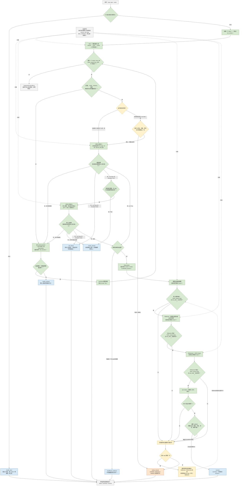

# A4-Gate 研究摘要 Agent（进行中）

> [!important] 状态边界
> `A4-Gate-C4a-1`、`C4a-2a / 2b1 / 2b2` 与 `C4b-1` 已完成教学实现、决定性验证和用户审核；父任务 `A4-Gate` 仍为 `DOING`。本页记录可复查的进行中项目进展，不是整关 PASS 复盘，也不升级求职证据。

## 目标与当前产物

- 目标：接收 `topic` 或受沙箱约束的 `relative_path`，只执行一个与请求匹配的工具，再基于本轮真实 Observation 生成带来源的三字段研究摘要。
- 设计合同：`C:\Users\26823\Desktop\AI-Agent-Learning\code\stage4\problem-contract.md`，整关通过前保持 `DRAFT`。
- 当前实现：`C:\Users\26823\Desktop\AI-Agent-Learning\code\stage4\a4_gate_research_summary_agent.py`。
- 证据链：`C:\Users\26823\Desktop\AI-Agent-Learning\daily\2026-08-11.md`、`2026-08-12.md`、`2026-08-13.md`、`2026-08-17.md`、`2026-08-18.md`、`2026-08-19.md`。
- 当前实现快照（2026-08-19 U1 审核后）：SHA-256 `D212A8A6A5B1C70F80B33B420C2253AD2A1F19714FA98984689A81A8CD57B173`，`TODO / NotImplementedError = 0 / 0`。

最终成功对象只能包含：

```json
{
  "status": "success",
  "summary": "非空摘要",
  "sources": ["本轮真实来源"]
}
```

## A4-Gate 完整流程图

> [!info] 图例与范围
> `✅` 表示已经获得当前项目证据，`⏳` 表示 Problem Contract 已冻结但实现或正式验收尚未完成。第二张图展示 **A4-Gate 最终目标控制流**；尚未完成的分支不能当成当前代码已经具备的能力。

### 1. 从需求合同到正式过关

```mermaid
flowchart LR
    PC["Problem Contract<br/>第 1～11 节已完成<br/>整关前保持 DRAFT"] --> C1["C1<br/>输入校验 + 固定三字段 PASS"]
    C1 --> C2["C2<br/>read_material / search_web PASS"]
    C2 --> C3A["C3a<br/>工具 Schema PASS"]
    C3A --> C3B["C3b<br/>白名单调度 + 参数硬校验 PASS"]
    C3B --> C3C["C3c<br/>模型 → 工具 → 候选摘要<br/>正常路径 PASS"]
    C3C --> C3D["C3d<br/>Reflection → Refinement<br/>→ 最终 validator PASS"]
    C3D --> C4A1["C4a-1<br/>共享 context、七字段日志、MAX、协议守门 PASS"]
    C4A1 --> C4A2A["C4a-2a<br/>一次同参数工具 retry 成功 PASS"]
    C4A2A --> C4A2B1["C4a-2b1<br/>二次失败 / 无 step<br/>needs_manual PASS"]
    C4A2B1 --> C4A2B2["C4a-2b2<br/>tool_failure / insufficient_evidence PASS"]
    C4A2B2 --> ACTION_REC["C4b-1<br/>Action correction + completion budget PASS"]
    ACTION_REC --> CAND_REC["candidate / Reflection / final validator<br/>失败恢复与安全停止 ⏳"]
    CAND_REC --> HITL["HITL<br/>危险 fake allow / deny ⏳"]
    HITL --> DATA["eval_cases.json<br/>10 normal + 3 failure + 1 danger<br/>至少 3 holdout ⏳"]
    DATA --> REVIEW{"A4-Gate 正式复核 ⏳"}
    REVIEW -->|"确定性合同与安全全过；语义阈值达标"| PASS["A4-Gate PASS"]
    REVIEW -->|"存在缺口"| RETRY["保留 A4-Gate = DOING<br/>定位并返回实际失败切片<br/>修复后重跑对应回归"]

    classDef designed fill:#d9eaf7,stroke:#0b5394,color:#1f1f1f;
    classDef done fill:#d9ead3,stroke:#38761d,color:#1f1f1f;
    classDef pending fill:#fff2cc,stroke:#bf9000,color:#1f1f1f;
    classDef gate fill:#d9eaf7,stroke:#0b5394,color:#1f1f1f;
    class PC designed;
    class C1,C2,C3A,C3B,C3C,C3D,C4A1,C4A2A,C4A2B1,C4A2B2,ACTION_REC done;
    class CAND_REC,HITL,DATA,RETRY pending;
    class REVIEW,PASS gate;
```



### 2. 目标运行时完整控制流



> [!warning] 当前代码与目标图的差异
> 当前已经验证无重试正常链、一次同参数工具重试、真实不可重试失败、搜索零证据、Action correction、修正/重试完整链预算和对应公开 `needs_manual`。尚未收口的是 candidate、Reflection 与最终 validator 失败恢复、HITL 和 eval；模型响应协议错误、API 异常与未知 reason 按设计继续原样传播，不能宣称所有异常都会被统一成业务状态。

正常无重试路径只使用 step 1～5，不伪造 step 6。一次工具重试成功路径已经证明正好使用 step 1～6：模型选择 → 工具失败 → 工具重试成功 → 候选模型 → Reflection → Refinement。任何第 7 次模型或工具调用都必须在计时与副作用之前拒绝。

未注入客户端时只创建一个 client；同一请求中的模型调用共用这个对象。每次公开请求只创建一个 `run_context`，其中保存非空 `request_id`、共享 `step` 和独立 `logs` 列表；内部账本不会进入最终三字段业务结果。恢复停止信号中的受控事实只用于生成用户可读的 `summary`，不会扩展成公开顶层字段，也不会公开 raw arguments、原始请求、prompt/messages、日志或 request ID。

## A4-Gate 实现步骤

| 阶段 | 当前状态 | 可观察结果 |
|---|---|---|
| Problem Contract | 已固定，整关前仍为 DRAFT | 输入、输出、工具、停止、日志、HITL 与 eval 边界明确 |
| C1 输入与三字段结果 | PASS | 非法请求零副作用；成功/失败结果都只用冻结字段 |
| C2 工具适配器 | PASS | `read_material` / `search_web` 的正常、失败与安全边界闭合 |
| C3 Schema、调度、生成/反思/改进/校验 | PASS | topic/path 四模型 + 一工具正常链及来源子集硬门闭合 |
| C4a-1 共享 context、日志、MAX、协议守门 | 已收口 | 无重试正常链 step 1～5、七字段日志、请求隔离与第 7 次调用硬门通过 |
| C4a-2a 一次同参数工具 retry | 已收口 | 首败后第二次成功形成完整六步恢复轨迹；两次工具尝试各自占步、计时、记日志 |
| C4a-2b1 自动恢复耗尽映射 | 已收口 | 二次可重试失败与重试前无剩余 step 均窄映射为严格三字段 `needs_manual` |
| C4a-2b2 其他工具结果映射 | 已收口 | 只对有账本来源证明的真实工具执行映射 `tool_failure`；工具成功但空结果映射 `insufficient_evidence` |
| C4b-1 Action correction 与预算停止 | 已收口 | 未知工具、坏 JSON/Schema、路由/值漂移可修正一次；修正局部上限和两类完整链预算在副作用前安全停止 |
| candidate / Reflection / final validator 恢复 | 未开始 | 候选链协议或验证失败时受控修正/停止 |
| HITL allow/deny | 未开始 | 危险 fake 在确认门前零执行 |
| 14 条 eval | 未开始 | 固定 normal/failure/danger/holdout 案例与阈值 |
| A4-Gate 正式复核 | 未开始 | 只有整关复核通过才可把父任务改为 PASS |

## 已完成切片

| 切片 | 状态 | 结果 |
|---|---|---|
| Problem Contract | 已冻结设计，仍为 DRAFT | 固定输入、输出、工具、停止、日志、HITL 与 eval 边界 |
| C1 / C2 | PASS | 请求准备、文件工具、搜索工具与错误边界闭合 |
| C3a / C3b / C3c | PASS | 工具 schema、白名单分发、两次模型 + 一次工具候选链闭合 |
| C3d-I1 | PASS | Reflection 单次调用与 SDK 响应外壳 fail-closed |
| C3d-I2 | PASS | Refinement JSON Output、`finish_reason`、`json.loads` 分层闭合 |
| C3d-I3 | PASS | Reflection → Refinement → validator 编排闭合 |
| C3d-I4 | PASS | 原始请求到可信三字段结果的 topic/path 正常链闭合 |
| C4a-1a～1d | 已收口 | 每请求独立 context、统一占步、固定七字段日志 helper 与 `MAX_STEPS=6` 硬门 |
| C4a-1e～1i | 已收口 | 四次模型与一次工具的真实调用点全部接入同一本调用账本 |
| C4a-1j | 已收口 | 首次响应只接受精确 `finish_reason == "tool_calls"` 后才读取/执行工具 |
| C4a-1k | 已收口 | topic/path 五步链、双请求隔离与第 7 次调用零副作用拒绝通过 |
| C4a-2a | 已收口 | 首次可重试失败后复用同一工具名、原始参数、规范化请求与运行上下文，只追加一次真实工具尝试；成功后继续完整六步链 |
| C4a-2b1 | 已收口 | 编排层发出专用恢复耗尽信号，公开入口只窄捕获该信号并返回 `needs_manual`；普通运行时错误保持原分类 |
| C4a-2b2 | 已收口 | 真实不可重试工具失败与成功零证据按 provenance 窄分类；执行前同形拒绝不误入工具终点 |
| C4b-1 G1 / I1a～I2d / U1 | PASS | 策略 B、Action correction、单 Action parser、执行来源分类、主链接线、工具 retry 完整链预算、公开映射与用户审核闭合 |

## 2026-08-19 C4a-2b2 / C4b-1 决定性证据

- `C4a-2b2` 用执行前后的 step/log provenance 区分“客户端预执行拒绝”和“真实工具已经失败”：前者账本不动并进入 Action correction；后者精确 `+1/+1` 后才可映射 `tool_failure`。搜索成功但结果为空窄映射为 `insufficient_evidence`，不得用模型常识补证据。
- C4b-1 选择策略 B：全局 `MAX_STEPS=6` 仍是硬保险丝，同时使用一次 Action correction / 一次工具 retry 的局部额度，以及“新动作之后是否还能走完可信尾链”的 completion budget。硬上限不是必须烧满的目标。
- 非法 Action 的来源模型调用照常记账；客户端预执行拒绝为零 tool step/log/backend；修正模型调用独立记账；只有修正后合法 Action 才产生真实工具 step/log。
- validation Observation 使用原始完整 invalid assistant 和逐字符相同的 `tool_call_id`；正文只包含安全校验信息，不回显 raw args、原始 request、prompt/messages、日志、request ID 或密钥。
- 模型响应外壳 parser 只守“是否能确定一个可配对的 Tool Action”。`choices` / `finish_reason` / tool_calls 数量、缺失 ID 等协议结构错误仍原样传播；未知工具、坏 JSON/Schema、类型、路由和值漂移才交给 executor 预检和 correction。
- 四条用户审核轨迹全部通过：

| 场景 | 事件与账本 | 真实工具 | 公开结果 |
|---|---|---:|---|
| 非法 → 修正合法 → 成功 | `M,M,T,M,M,M`，`6/6` | 1 | `success` |
| 非法 → 修正仍非法 | `M,M`，`2/2` | 0 | `needs_manual`，Action 修正上限 |
| 初始合法 → 首败 → retry 成功 | `M,T,T,M,M,M`，`6/6` | 2 | `success` |
| 修正合法 → 首工具 retryable | `M,M,T`，`3/3` | 1；第二次为 0 | `needs_manual`，完整链预算不足 |

- I2d 原始公开映射矩阵 `15/15` 场景、`138/138` 断言通过；机械清理后回归 `15/15` 场景、`150/150` 断言通过。三种预算停止都返回严格 `status / summary / sources`，无证据时 `sources=[]`；未知 reason、异常子类、API / 协议 / `ValueError` 保持原异常 identity。
- `py_compile` 与 `git diff --check` 均通过；U1 用户最终审核“通过”。当前源码 SHA-256 为 `D212A8A6A5B1C70F80B33B420C2253AD2A1F19714FA98984689A81A8CD57B173`，源码内 `TODO / NotImplementedError = 0 / 0`。
- 对应实现与学习证据已提交为 [`da7751f`](https://github.com/humbleded/AI-Agent-Learning/commit/da7751f2525c5de3a2ecb7a9da9d94bed7d7f7d3)。
- 这些证据只关闭 C4b-1 教学/实现子单元。父 `A4-Gate` 仍为 `DOING`，尚未完成 candidate / Reflection / final validator 恢复、HITL、14 条 eval、Gate 五个必答题和正式复核。

## 2026-08-17～18 C4a-2 决定性证据

- `C4a-2a` 已证明一次同参数恢复：首次工具返回精确 `ok=False / retryable=True` 后，编排层复用同一工具名、同一个原始参数字符串、同一规范化请求与同一本 `run_context`，只追加一次真实工具尝试。
- 首败后第二次成功的完整轨迹为模型 4 次、工具 2 次、step / 日志 `[1,2,3,4,5,6]`；第一次失败只留在调用账本，只有第二次成功结果进入 Tool Observation，随后继续候选摘要、Reflection 与 Refinement。
- 2026-08-17 使用内存首败注入配合真实 DeepSeek 下游调用验证六步恢复链；测试夹具与真实模型输出分开记录，没有把注入失败冒充真实外部故障。
- `C4a-2b1` 完整无落盘 fake / spy 矩阵为 `15/15 PASS`：覆盖正常五步、恢复六步、两个恢复耗尽终点、首次 / 二次不可重试、畸形结果、普通异常原对象传播、固定七字段日志和请求隔离。
- 二次可重试失败：模型 1 次、工具 2 次、日志 `[1,2,3]`；公开结果严格为 `status / summary / sources`，没有第三次工具、候选第二模型、Reflection 或 Refinement。
- 重试前无剩余 step：从初始 step 4 得到模型 step 5、首工具 step 6；模型 1 次、工具 1 次、日志 `[5,6]`，第二次工具保持零副作用、零计时、零日志。
- 两种 `needs_manual` 的 `summary` 都说明具体阈值、真实尝试次数、最后错误、可信证据缺口和停止自治 / 人工交接，且 `sources=[]`；内部 reason、日志、request ID 与工具结果不进入公开顶层合同。
- 用户最终确认两条轨迹符合设计意图。该结论只闭合 `C4a-2a / C4a-2b1` 教学实现单元，不等于父 `A4-Gate` 正式 PASS。

## 2026-08-12～13 C4a-1 决定性证据

- S6 独立协议矩阵 `102/102`；S7 主审 115 条断言、独立矩阵 `46/46`，独立 S6/S7/静态合计 `150/150`。
- topic 与 relative_path 两路日志步号均严格为 `[1, 2, 3, 4, 5]`，事件为 `model_call → tool_call → model_call → model_call → model_call`；每条事件恰好固定七字段，同一请求共享一个 request ID。
- 两次公开入口调用的 context、logs 列表与 request ID 彼此独立，各自从 step 1 开始；最终公开结果仍精确为 `status / summary / sources`。
- context 初始 step 2 时，前四次真实调用占 3～6；Refinement 的第 7 次尝试在计时、模型调用与日志追加之前拒绝，既有日志保持不变。
- 首次模型缺少结束原因或其值不是精确 `"tool_calls"` 时，只保留 step 1 的 API 成功日志，message 读取、工具和全部下游调用均为 0。
- 本轮没有重跑真实 DeepSeek；决定性 C4a-1 证据来自无网络内存 fake/spy。2026-08-11 的两条真实正常链证据继续有效，但不能冒充本轮重跑。

## 2026-08-11 决定性证据

- 主审离线矩阵：`129/129`，包括 Reflection 47、Refinement 52、I3 编排 12、I4 wrapper 16、正则复测 2。
- 独立复核：冻结范围合同 `40/40`、实际 fail-closed 链 `3/3`、入口与异常传播 `7/7`，`FAILED_IDS=[]`。
- 真实 DeepSeek topic 路径：模型 4 次、`search_web` 1 次，结束序列为 `tool_calls → stop → stop → stop`，最终 2 个来源均来自本轮搜索结果。
- 真实 DeepSeek `relative_path=sample.txt` 路径：模型 4 次、`read_material` 1 次，结束序列相同，最终来源精确为 `sample.txt`。
- 两条真实路径的 Reflection 请求均无 `response_format`；Refinement 均使用 `response_format={"type":"json_object"}`、`max_tokens=1600`。
- `max_tokens=1600` 继续作为观测期上限：反复出现 `finish_reason="length"` 才增大；长期代表性输出远低于上限且质量持续通过，才考虑调小。

## 关键订正

1. OpenAI 兼容 SDK 返回的是属性对象，不是嵌套 `dict`；响应必须按 `response → choices[0] → message` 读取。
2. `finish_reason` 位于 `choice`，不是 `message`；Reflection 与 Refinement 当前只接受 `stop`。
3. 外部响应缺字段、非 `stop`、意外 tool calls、空正文或坏 JSON 都属于运行时协议失败，应 fail-closed 为 `RuntimeError`，不能泄漏 `AttributeError` 或伪造成功。
4. `prepare_request()` 返回二项结果，入口必须先解包规范化请求与非法结果；C3c 返回三键字典，必须按精确键取值，不能直接迭代解包字典。
5. `response_format={"type":"json_object"}` 只约束模型输出形式，SDK 仍返回字符串；必须经过 `json.loads`，再由 validator 做业务合同校验。
6. 调用前顺序必须是 `reserve → clock → 真实调用`；硬门晚于计时或副作用，就无法证明第 7 次调用为零副作用。
7. `try` 只包真实模型/工具调用；成功日志放 `else`，异常日志记录 `type(exc).__name__` 后裸抛。`finally return` 会覆盖原异常，原异常对象也不能直接写入只接受安全字符串的日志合同。
8. 首次模型工具选择的结束原因是精确协议字面值 `"tool_calls"`。应采用一个 allow 条件统一拒绝其他值，不能把单数 `"tool_call"` 或互斥的 `"stop"` 分支混进正常路径。
9. `execute_tool_call()` 只负责一次原子尝试；只有持有前后结果、重试预算和共享上下文的编排层，才能判断自动恢复是否耗尽。
10. 每次真实重试必须再次进入原子入口，由入口自行占 step、计时和记日志；手工增加 step 会产生幽灵步号或提前撞上硬门。
11. 内层正常三键与公开最终三字段是不同合同。自动恢复耗尽应通过专用内部信号传递，公开入口只窄捕获该信号；宽泛捕获 `RuntimeError` 会把协议错误和程序错误伪装成人工接管。
12. 第一次失败应保留在内部账本中供审计，但不能作为成功 Tool Observation 污染模型历史；失败证据可见不等于失败内容可以继续驱动下游模型。
13. SDK-like 响应对象可能定义为 falsey；响应结构门必须使用 `response is None` 与显式属性检查，不能用 `if not response` 把合法对象误判为空。
14. `tool_call_id` 是协议关联键：只用 strip 判空，回填时保留原始字符串；validation Observation 必须紧跟原始完整 invalid assistant，不能把 tool 消息包进新的 assistant content。
15. Action response parser 与 executor 的职责不能混用：parser 只检查能否确定一个可关联 Action，工具名/参数内容校验留给 executor；工具结果也不能再次交给 Action parser。
16. `MAX_STEPS` 只负责全局硬门。局部修正/重试额度和完整链预算要在新模型或第二次工具副作用之前独立检查，已知无法完成时应提前停止。
17. 公开预算映射必须同时匹配精确异常类型和精确 reason；未知 reason 与异常子类 fail-closed 原样传播，不能由默认 `else` 冒充既有停止原因。

## 安全边界

- `allowed_sources` 只能从本轮真实 Observation 派生；最终 `sources` 必须是它的非空子集。
- Prompt 中的来源名单是软约束，客户端 validator 才是硬门。
- 来源身份属于 allowlist 只能证明“引用来自本轮工具结果”，不能单独证明摘要中的每个事实都被正文支持；语义真实性仍需固定 eval 与人工抽查。
- 非法输入会在 client、模型和工具之前返回；Reflection 与 Refinement 均不暴露工具。
- 重试只允许发生在精确 `ok is False and retryable is True` 的分支；第二次成功继续正常链，第二次不可重试、畸形结果和普通 Python 异常不能被耗尽信号误吞。
- `ok=False, retryable=False` 不足以单独证明 `tool_failure`；只有 `run_context` 与七字段账本证明真实工具已执行时才可映射，执行前的同形拒绝仍属于动作校验 / 修正范围。
- `MAX_TOOL_RETRIES=1` 表示首次尝试后最多追加 1 次，因此工具总尝试数最多为 2；达到上限后不得出现第三次工具调用。
- `MAX_ACTION_CORRECTIONS=1` 表示非法 Action 最多请求一次模型修正；修正仍非法时不发第二次 correction，也不执行真实工具。
- correction 前至少保留 5 个调用位置；第一次工具可重试失败后至少保留 4 个调用位置。完整链不足时停止的原因不能误写为“局部次数已经耗尽”。
- 当前同参数重试只在受控只读工具上获得证据，不能直接外推到支付、发送、部署等有副作用操作；写操作还需幂等键、去重与 HITL 风险门。

## 当前切片与后续未完成范围

父任务仍缺：

- candidate、Reflection 与最终 validator 响应/校验失败的受控修正或安全停止。
- HITL：高风险 fake 工具的 allow/deny 可执行证据。
- `eval_cases.json`：14 条固定案例、至少 3 条 holdout 和正式 Gate 阈值。
- Gate 的循环、停止、工具恢复、幻觉点和可测试验收规则五个必答题。
- 正式 Gate 复核；在此之前不新建 A4-Gate PASS 复盘，也不升级岗位证据。

截至 2026-08-19，`C4a-2b2` 与 `C4b-1` 已收口，当前没有活动代码 TODO；它们没有替代父任务剩余范围，也没有把 `tracker/progress.md` 中的 `A4-Gate` 从 `DOING` 改为 `PASS`。

## 相关链接

- [[../../../02-Concepts/Agent/反思机制(Reflection)|反思机制]]
- [[../../../02-Concepts/Agent/受控重试与人工接管(Bounded Retry and Human Handoff)|受控重试与人工接管]]
- [[../../../02-Concepts/LLM/结构化输出(Structured Output)|结构化输出]]
- [[../../../02-Concepts/LLM/函数调用(Function Calling)|函数调用 / Tool Calling]]
- [[../../../03-Courses/Agent/AI-Agent-Learning/stage4-agent-basics|阶段 4：Agent 基础原理]]
- [[../../../raw/conversations/2026-08-13-ai-agent-learning-a4-gate-c4a-1-session-handoff|C4a-1 会话接力摘要]]
