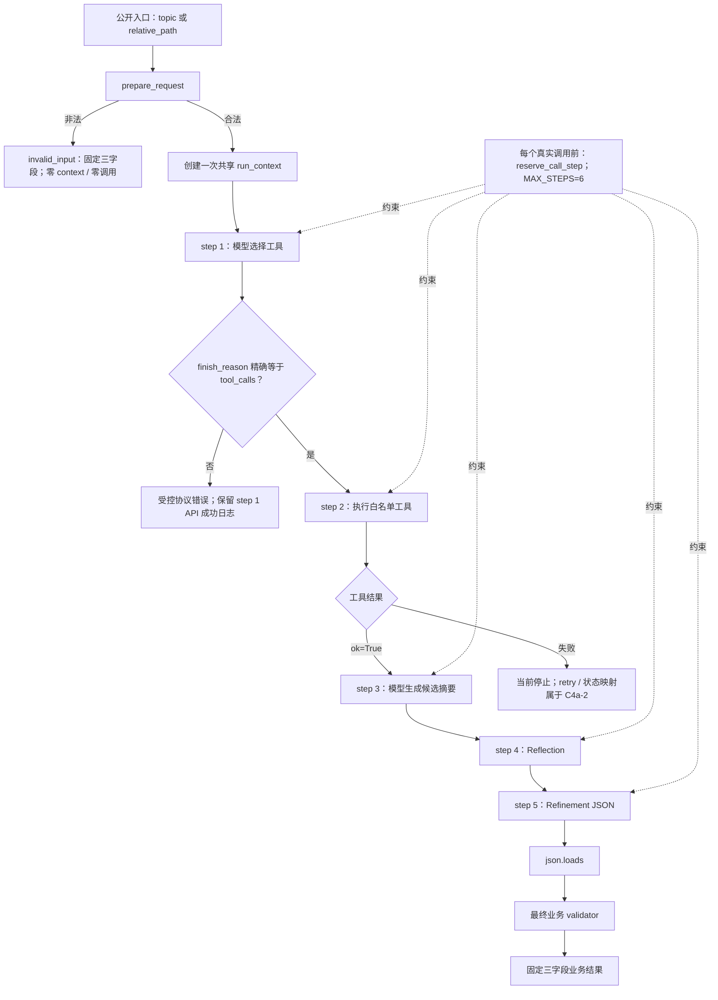

# A4-Gate 研究摘要 Agent（进行中）

> [!important] 状态边界
> `A4-Gate-C4a-1` 已于 2026-08-13 收口；父任务 `A4-Gate` 仍为 `DOING`。本页记录可复查的进行中项目进展，不是整关 PASS 复盘，也不升级求职证据。

## 目标与当前产物

- 目标：接收 `topic` 或受沙箱约束的 `relative_path`，只执行一个与请求匹配的工具，再基于本轮真实 Observation 生成带来源的三字段研究摘要。
- 设计合同：`C:\Users\26823\Desktop\AI-Agent-Learning\code\stage4\problem-contract.md`，整关通过前保持 `DRAFT`。
- 当前实现：`C:\Users\26823\Desktop\AI-Agent-Learning\code\stage4\a4_gate_research_summary_agent.py`。
- 证据链：`C:\Users\26823\Desktop\AI-Agent-Learning\daily\2026-08-11.md`、`2026-08-12.md`、`2026-08-13.md`。

最终成功对象只能包含：

```json
{
  "status": "success",
  "summary": "非空摘要",
  "sources": ["本轮真实来源"]
}
```

## 当前可信运行流程



正常无重试路径只使用 step 1～5，不伪造 step 6。step 6 是共享预算余量，不代表 retry 已实现；C4a-2 若发生第二次真实工具尝试，必须独立占下一步并追加一条新日志。

未注入客户端时只创建一个 client；四次模型请求共用这个对象。每次公开请求只创建一个 `run_context`，其中保存非空 `request_id`、共享 `step` 和独立 `logs` 列表；内部账本不会进入最终三字段业务结果。

## A4-Gate 实现步骤

| 阶段 | 当前状态 | 可观察结果 |
|---|---|---|
| Problem Contract | 已固定，整关前仍为 DRAFT | 输入、输出、工具、停止、日志、HITL 与 eval 边界明确 |
| C1 输入与三字段结果 | PASS | 非法请求零副作用；成功/失败结果都只用冻结字段 |
| C2 工具适配器 | PASS | `read_material` / `search_web` 的正常、失败与安全边界闭合 |
| C3 Schema、调度、生成/反思/改进/校验 | PASS | topic/path 四模型 + 一工具正常链及来源子集硬门闭合 |
| C4a-1 共享 context、日志、MAX、协议守门 | 已收口 | 无重试正常链 step 1～5、七字段日志、请求隔离与第 7 次调用硬门通过 |
| C4a-2 retry 与失败状态映射 | 下一 Session | 首先完成一次同参数工具 retry 成功的六步轨迹 |
| 动作/候选校验恢复 | 未开始 | 未知动作或候选失败时受控修正/停止 |
| HITL allow/deny | 未开始 | 危险 fake 在确认门前零执行 |
| 14 条 eval | 未开始 | 固定 normal/failure/danger/holdout 案例与阈值 |
| A4-Gate 正式复核 | 未开始 | 只有整关复核通过才可把父任务改为 PASS |

## 已完成切片

| 切片 | 状态 | 结果 |
|---|---|---|
| Problem Contract | 已冻结设计，仍为 DRAFT | 固定输入、输出、工具、停止、日志、HITL 与 eval 边界 |
| C1 / C2 | PASS | 请求准备、文件工具、搜索工具与错误边界闭合 |
| C3a / C3b / C3c | PASS | 工具 schema、白名单分发、两次模型 + 一次工具候选链闭合 |
| C3d-I1 | PASS | Reflection 单次调用与 SDK 响应外壳 fail-closed |
| C3d-I2 | PASS | Refinement JSON Output、`finish_reason`、`json.loads` 分层闭合 |
| C3d-I3 | PASS | Reflection → Refinement → validator 编排闭合 |
| C3d-I4 | PASS | 原始请求到可信三字段结果的 topic/path 正常链闭合 |
| C4a-1a～1d | 已收口 | 每请求独立 context、统一占步、固定七字段日志 helper 与 `MAX_STEPS=6` 硬门 |
| C4a-1e～1i | 已收口 | 四次模型与一次工具的真实调用点全部接入同一本调用账本 |
| C4a-1j | 已收口 | 首次响应只接受精确 `finish_reason == "tool_calls"` 后才读取/执行工具 |
| C4a-1k | 已收口 | topic/path 五步链、双请求隔离与第 7 次调用零副作用拒绝通过 |

## 2026-08-12～13 C4a-1 决定性证据

- S6 独立协议矩阵 `102/102`；S7 主审 115 条断言、独立矩阵 `46/46`，独立 S6/S7/静态合计 `150/150`。
- topic 与 relative_path 两路日志步号均严格为 `[1, 2, 3, 4, 5]`，事件为 `model_call → tool_call → model_call → model_call → model_call`；每条事件恰好固定七字段，同一请求共享一个 request ID。
- 两次公开入口调用的 context、logs 列表与 request ID 彼此独立，各自从 step 1 开始；最终公开结果仍精确为 `status / summary / sources`。
- context 初始 step 2 时，前四次真实调用占 3～6；Refinement 的第 7 次尝试在计时、模型调用与日志追加之前拒绝，既有日志保持不变。
- 首次模型缺少结束原因或其值不是精确 `"tool_calls"` 时，只保留 step 1 的 API 成功日志，message 读取、工具和全部下游调用均为 0。
- 本轮没有重跑真实 DeepSeek；决定性 C4a-1 证据来自无网络内存 fake/spy。2026-08-11 的两条真实正常链证据继续有效，但不能冒充本轮重跑。

## 2026-08-11 决定性证据

- 主审离线矩阵：`129/129`，包括 Reflection 47、Refinement 52、I3 编排 12、I4 wrapper 16、正则复测 2。
- 独立复核：冻结范围合同 `40/40`、实际 fail-closed 链 `3/3`、入口与异常传播 `7/7`，`FAILED_IDS=[]`。
- 真实 DeepSeek topic 路径：模型 4 次、`search_web` 1 次，结束序列为 `tool_calls → stop → stop → stop`，最终 2 个来源均来自本轮搜索结果。
- 真实 DeepSeek `relative_path=sample.txt` 路径：模型 4 次、`read_material` 1 次，结束序列相同，最终来源精确为 `sample.txt`。
- 两条真实路径的 Reflection 请求均无 `response_format`；Refinement 均使用 `response_format={"type":"json_object"}`、`max_tokens=1600`。
- `max_tokens=1600` 继续作为观测期上限：反复出现 `finish_reason="length"` 才增大；长期代表性输出远低于上限且质量持续通过，才考虑调小。

## 关键订正

1. OpenAI 兼容 SDK 返回的是属性对象，不是嵌套 `dict`；响应必须按 `response → choices[0] → message` 读取。
2. `finish_reason` 位于 `choice`，不是 `message`；Reflection 与 Refinement 当前只接受 `stop`。
3. 外部响应缺字段、非 `stop`、意外 tool calls、空正文或坏 JSON 都属于运行时协议失败，应 fail-closed 为 `RuntimeError`，不能泄漏 `AttributeError` 或伪造成功。
4. `prepare_request()` 返回二项结果，入口必须先解包规范化请求与非法结果；C3c 返回三键字典，必须按精确键取值，不能直接迭代解包字典。
5. `response_format={"type":"json_object"}` 只约束模型输出形式，SDK 仍返回字符串；必须经过 `json.loads`，再由 validator 做业务合同校验。
6. 调用前顺序必须是 `reserve → clock → 真实调用`；硬门晚于计时或副作用，就无法证明第 7 次调用为零副作用。
7. `try` 只包真实模型/工具调用；成功日志放 `else`，异常日志记录 `type(exc).__name__` 后裸抛。`finally return` 会覆盖原异常，原异常对象也不能直接写入只接受安全字符串的日志合同。
8. 首次模型工具选择的结束原因是精确协议字面值 `"tool_calls"`。应采用一个 allow 条件统一拒绝其他值，不能把单数 `"tool_call"` 或互斥的 `"stop"` 分支混进正常路径。

## 安全边界

- `allowed_sources` 只能从本轮真实 Observation 派生；最终 `sources` 必须是它的非空子集。
- Prompt 中的来源名单是软约束，客户端 validator 才是硬门。
- 来源身份属于 allowlist 只能证明“引用来自本轮工具结果”，不能单独证明摘要中的每个事实都被正文支持；语义真实性仍需固定 eval 与人工抽查。
- 非法输入会在 client、模型和工具之前返回；Reflection 与 Refinement 均不暴露工具。

## 尚未完成与下一切片

父任务仍缺：

- `C4a-2`：一次同参数工具 retry；不可重试、二次失败、无预算与空证据的冻结状态映射。
- 未知动作 / 坏参数与候选验证失败的受控修正或安全停止。
- HITL：高风险 fake 工具的 allow/deny 可执行证据。
- `eval_cases.json`：14 条固定案例、至少 3 条 holdout 和正式 Gate 阈值。
- 正式 Gate 复核；在此之前不新建 A4-Gate PASS 复盘，也不升级岗位证据。

下一 Session 从 `A4-Gate-C4a-2a` 开始：只证明“可重试工具首次失败 → 使用同一参数最多重试一次并成功”，使两次真实工具尝试分别占步、计时和写日志，形成正好六步的成功恢复轨迹。

## 相关链接

- [[../../../02-Concepts/Agent/反思机制(Reflection)|反思机制]]
- [[../../../02-Concepts/LLM/结构化输出(Structured Output)|结构化输出]]
- [[../../../02-Concepts/LLM/函数调用(Function Calling)|函数调用 / Tool Calling]]
- [[../../../03-Courses/Agent/AI-Agent-Learning/stage4-agent-basics|阶段 4：Agent 基础原理]]
- [[../../../raw/conversations/2026-08-13-ai-agent-learning-a4-gate-c4a-1-session-handoff|C4a-1 会话接力摘要]]
